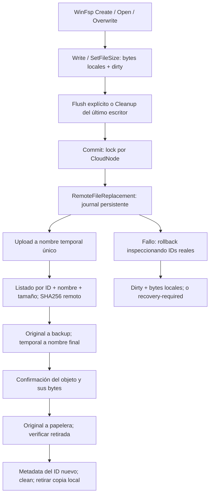

# Ruta de escritura

Código examinado: `O2VirtualFileSystem`, `O2CloudFileStore`, `ICloudFileStore`, `CloudNode`, `O2CloudApiClient` y `O2DriveMountService`.

## Antes

`Overwrite` vaciaba los bytes locales. `Write`/`SetFileSize` mantenían WriteCache y size. `Flush` devolvía éxito sin persistir. `Cleanup` llamaba a `Commit`, que limpiaba dirty y lanzaba `Task.Run`. El upload recibía padre/nombre/bytes, no el ID original. La retirada del ID anterior tenía un catch vacío; el catch exterior de upload tampoco devolvía fallo al llamador. Después `ApplyMetadata` aceptaba el DTO devuelto y eliminaba la copia local. `ApplyMetadata` no cambia el nombre/diccionario local; una enumeración nueva podía exponer nombres distintos a los mantenidos en memoria.

## Ahora

`Commit` es síncrono respecto al llamador y serializa las mutaciones de cada nodo. La red de reemplazo se ejecuta fuera de `_gate`, para no bloquear todo el store durante un upload. Solo se pone clean después de confirmación. Se conserva `RemoteItem` anterior a los cambios de bytes: su tamaño/fingerprint no se confunden con los nuevos.

`Flush(file)` invoca Commit y puede devolver fallo mediante el adaptador de excepciones de WinFsp. Cleanup también intenta Commit, pero **Windows no ofrece un resultado de error para Cleanup**: un cierre sin Flush explícito no permite garantizar un error visible en la aplicación. El fallo queda registrado por el manejador de WinFsp y conserva dirty/caché/journal. No se presenta esta limitación como resuelta.

La prueba montada reveló que `PostCleanupWhenModifiedOnly=true` omitía el caso de truncado a cero sin Write. Se cambió a false; el test pasó. Se cuenta cada handle escritor: cerrar uno de lectura no sube contenido de un escritor aún abierto; con varios escritores Cleanup persiste al cerrar el último. Flush explícito puede persistir con otros handles abiertos, como operación solicitada sobre el archivo.

ReadCache identifica bloques por hash de ID/fingerprint/size/fecha/URL. El ID nuevo confirmado evita reutilizar bloques antiguos. La copia local dirty manda mientras hay escrituras; no se elimina ante fallo. No se vacía indiscriminadamente la caché de lectura. Las cachés de escritura/journals de sesiones anteriores ya no se purgan al arrancar.

No se ha añadido un Flush global de volumen ni cambiado todos los locks/red de lectura/rename del proyecto. La mejora de serialización se refiere al tramo de reemplazo y a sus mutadores, no a una reimplementación completa del filesystem.
